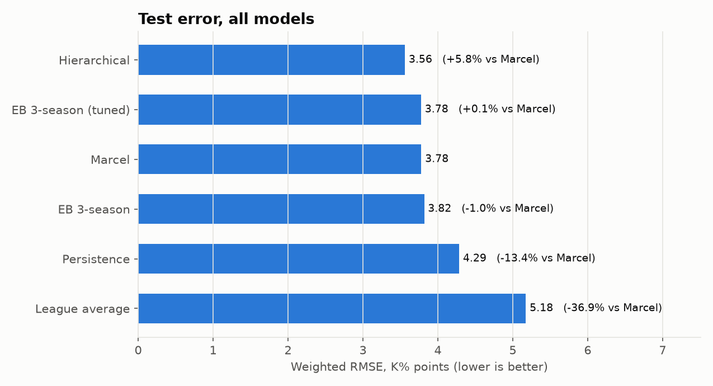
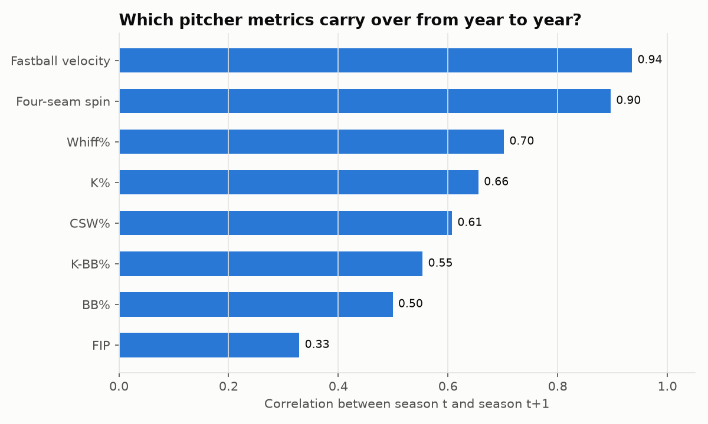
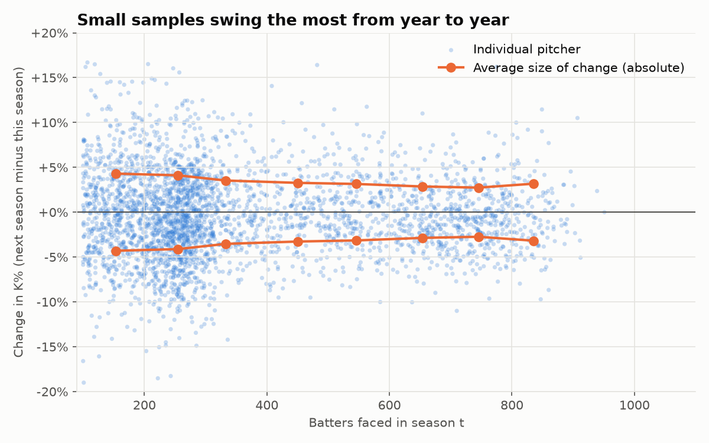
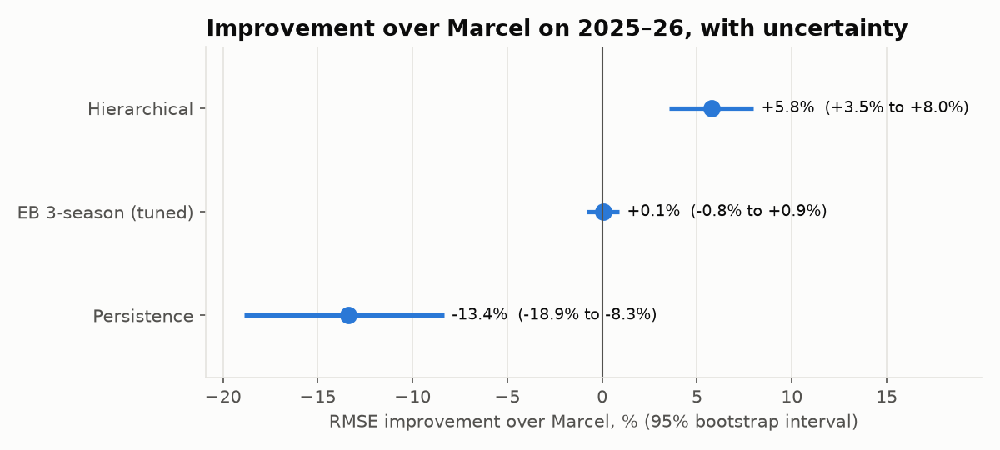
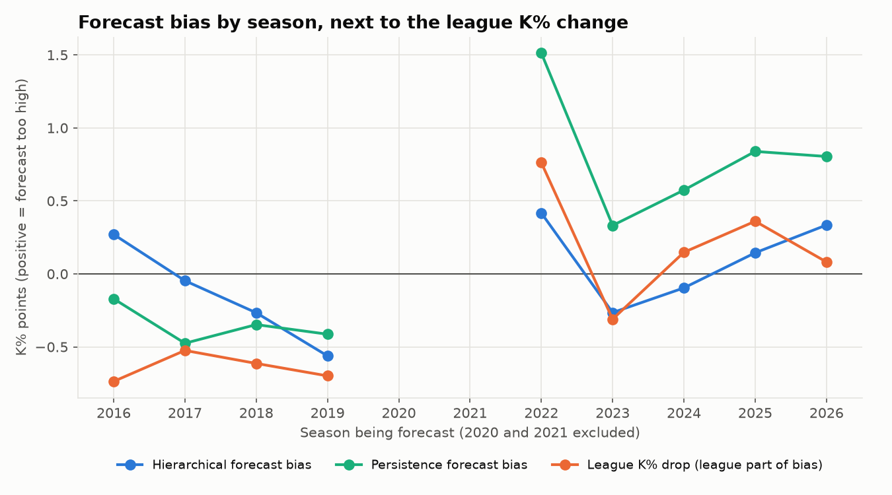
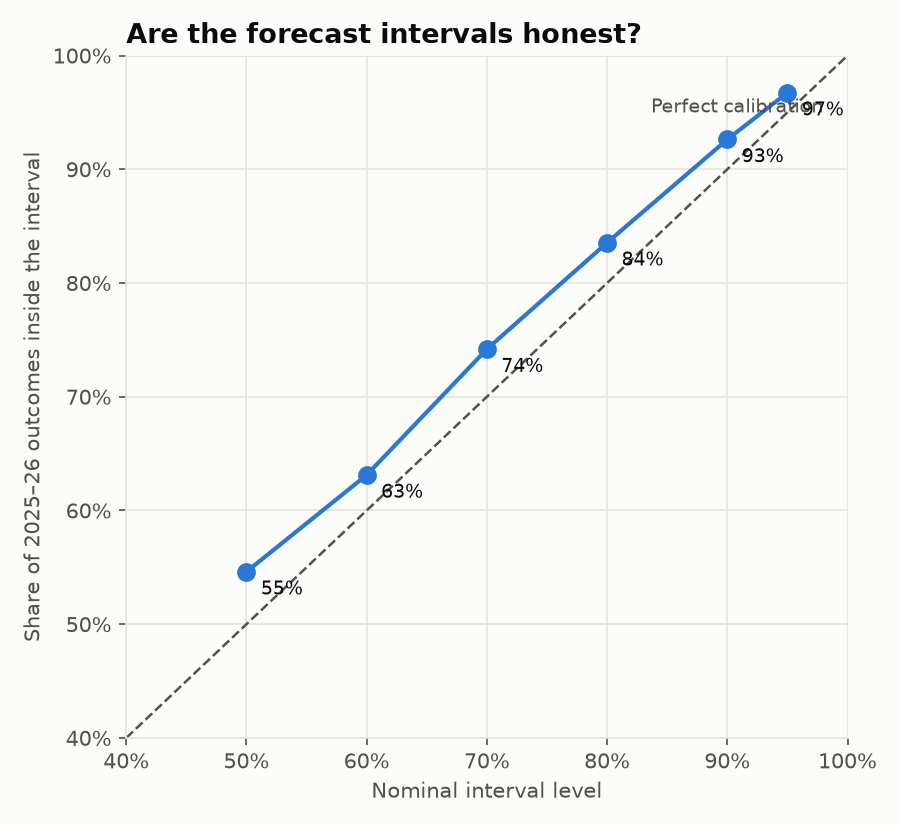
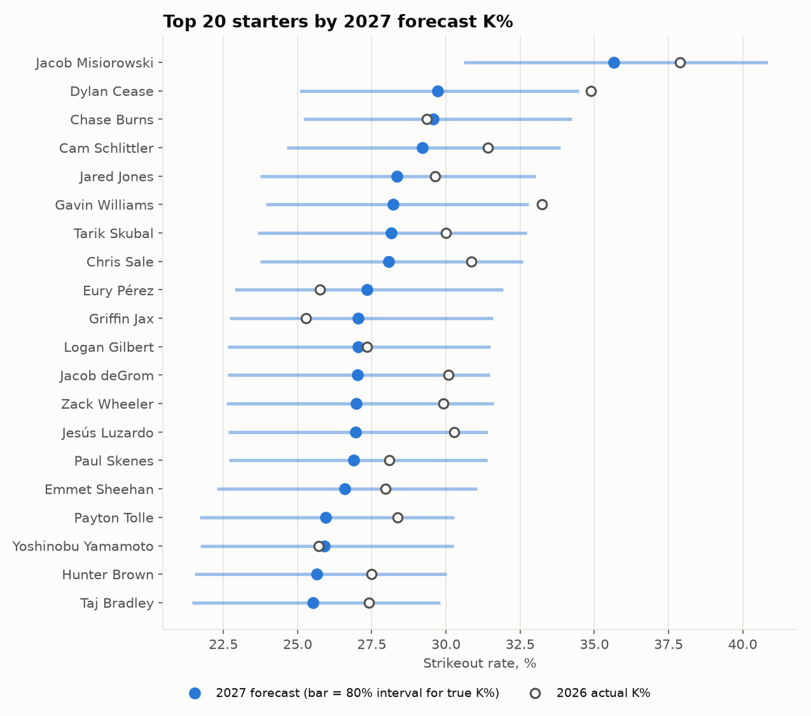
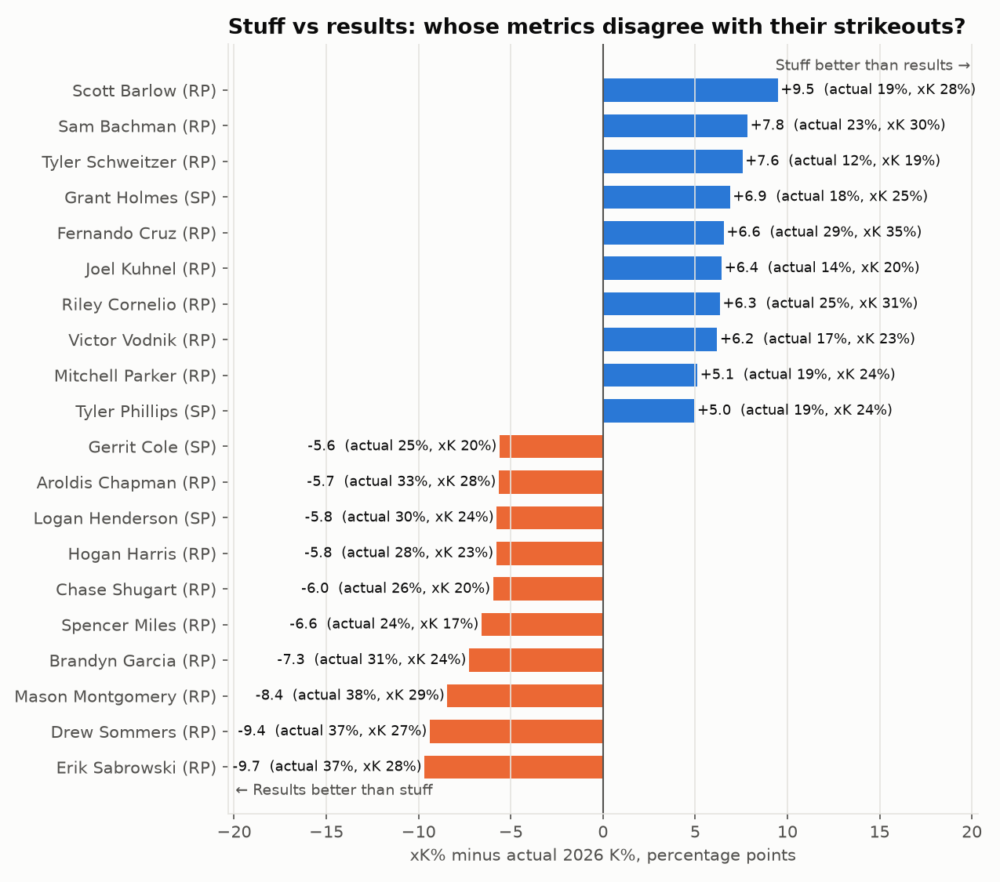

# Forecasting MLB Pitcher Strikeout Rates with Bayesian Shrinkage

How well can one season of Statcast data predict a pitcher's strikeout rate the next season, and can a Bayesian model beat the standard baselines?

This project forecasts next-season strikeout rate (K%) for MLB pitchers using 12 seasons of Statcast pitch data (2015–2026). It compares simple baselines against empirical Bayes shrinkage and a hierarchical Bayesian model built in PyMC, tests the results on held-out seasons, diagnoses a league-wide forecasting bias, and publishes 2027 forecasts with calibrated uncertainty intervals.

## Key results

- **The final hierarchical model beats Marcel**, the classic projection baseline, by **5.8%** in forecast error on held-out 2025–26 seasons (95% bootstrap interval: +3.5% to +8.0%), and beats "next year equals last year" by 16.9%.
- **Its uncertainty is honest.** 80% predictive intervals contained 83.5% of actual outcomes, and 95% intervals contained 96.7%.
- **The biggest single improvement came from diagnosing a bias, not from a more complex model.** Every method over-forecast strikeouts after 2021 because returning pitchers lose more ground relative to the league than they used to. One era term fixed most of it: test bias fell from +0.84 to +0.24 points, and RMSE fell from 3.66 to 3.56.
- **2027 forecasts** for 517 pitchers, plus an expected-strikeout-rate (xK%) comparison that flags whose 2026 results disagree with their stuff.

| Model (2025–26 test seasons) | Weighted RMSE (K% pts) | vs. Marcel |
|---|---|---|
| League average | 5.18 | −36.9% |
| Persistence (next year = last year) | 4.29 | −13.4% |
| Marcel | 3.78 | — |
| Empirical Bayes, 3 seasons (tuned) | 3.78 | +0.1% |
| **Hierarchical Bayesian + era term** | **3.56** | **+5.8%** |



---

## Data

- **Source:** Baseball Savant Statcast pitch-level data via [pybaseball](https://github.com/jldbc/pybaseball), regular season 2015–2026. Names and birth dates come from the MLB Stats API.
- **Pitcher-seasons:** 9,836, built by aggregating pitches into batters faced, K%, BB%, whiff rate, CSW%, fastball velocity, four-seam spin, FIP, and role (starter if at least half of a pitcher's appearances were starts).
- **Modeling table:** 3,243 pairs of season *t* → season *t+1*, built with SQL in SQLite. Each pair requires 100+ batters faced in both seasons. Pairs involving the 60-game 2020 season are excluded.
- **Validation:** forecasts made after the 2015–2023 seasons are the training set (2,538 pairs). Forecasts of 2025 and 2026 are the test set (705 pairs from 457 pitchers), used only at the end. Every forecast uses only information available at the time it would have been made. Errors are weighted by next-season batters faced.

**A note on FIP:** Statcast has no earned-run flag, so the FIP constant is scaled to league runs per 9 innings rather than ERA. This shifts the overall level slightly but doesn't affect rankings.

---

## Approach

### 1. Exploratory analysis



- **Whiff rate is stickier than K% itself** (year-to-year r = 0.70 vs. 0.66). FIP is much noisier (0.33), which is why K% is the forecasting target.
- Next-season K% keeps about two-thirds of a pitcher's distance from average (fitted slope 0.66): regression to the mean.
- Year-to-year swings shrink from 4.3 to 2.7 K% points as sample size grows from 100–200 to 700–800 batters faced, which motivates shrinkage that depends on sample size.
- Relievers strike out more batters than starters (24.5% vs. 21.5%) and are less stable, which motivates role-specific priors.
- K%, whiff rate, and CSW% are highly collinear (r ≈ 0.8).



### 2. Baselines

- **League average:** last season's league K% for everyone.
- **Persistence:** next year equals last year.
- **Marcel:** the last three seasons weighted 5/4/3, regressed toward the league mean, and age-adjusted. The amount of regression was tuned on the training years (about 140 batters faced of league-average performance).

Marcel beat persistence by 11.8% on the test seasons and in every season from 2016 to 2026. It's the main benchmark.

### 3. Empirical Bayes shrinkage

A beta-binomial model with a Beta prior on true strikeout rate, fit by method of moments separately for starters and relievers in each season. Posterior mean: (K + α) / (BF + α + β).

- The fitted priors are worth 45–95 batters faced. Reliever talent is more spread out (SD 4.5–6.3 points vs. 4.1–5.3 for starters), so relievers get weaker priors.
- **Forecasting needs more shrinkage than estimation.** The best prior strength for forecasting was 2.45× the empirical Bayes estimate, because true talent also changes from season to season.
- On its own, shrinkage only matched Marcel. The gains come from adding skill metrics.

### 4. Hierarchical Bayesian model (PyMC)

```
K(t+1) ~ Binomial(BF(t+1), p)
logit(p) = a[role]                  role-specific intercept
         + b · features(t)          standardized skill metrics from season t
         + c · post2021             era term (forecasts of 2022 onward)
         + e[pitcher-season]        season-to-season talent change, e ~ Normal(0, σ)
```

**Features:** 3-season empirical Bayes K% (logit), whiff rate, BB%, fastball velocity, velocity change, four-seam spin (with a flag for pitchers without a four-seamer), age, and age squared.

**Fit:** NUTS via nutpie, 4 chains × 1,000 draws after 1,000 tuning iterations. All R-hat values ≤ 1.005, with zero divergences. The pitcher-season term is what makes the predictive intervals honest: without it, they would reflect only binomial luck.

| Feature | Effect on next-season K% (per 1 SD) |
|---|---|
| 3-season EB K% | +3.2 points |
| Fastball velocity | +0.5 |
| Four-seam spin | +0.4 |
| Whiff rate | +0.4 |
| Velocity change | +0.3 |
| Age | −0.3 |
| BB%, age squared, no four-seamer | ≈ 0 |

**A model that was dropped.** A version with a partially pooled pitcher effect, for pitchers who consistently beat their metrics, never converged (R-hat 1.07, still 1.03 after doubling the draws), and its posterior sat near zero. Once three seasons of shrunk K% and Statcast metrics are in the model, little pitcher-specific signal remains. Removing it left accuracy unchanged and fixed convergence.

### 5. Evaluation and the era fix

**Is the improvement real?** I bootstrapped the test set by resampling *pitchers* (most appear in both test seasons), 5,000 times. The final model beat Marcel in every resample.



**Where the bias came from.** Every method under-forecast 2016–2019 and over-forecast 2022–2026. For persistence, the bias splits exactly into a league part and a pitcher part:

| Seasons forecast | Persistence bias | League K% part | Returning-pitcher part |
|---|---|---|---|
| 2016–2019 | −0.35 | −0.64 | +0.29 |
| 2022–2026 | +0.81 | +0.21 | +0.60 |

Returning pitchers lose ground relative to the league in *every* season. Before 2020, rising league strikeout rates hid that. Since 2022, the decline has roughly doubled, and it drives the over-forecasting.

**The fix.** One era term for forecasts of 2022 onward, which uses only which season is being forecast. It was estimated at about **−1.1 K% points**:

| | Without era term | With era term |
|---|---|---|
| Test RMSE | 3.66 | **3.56** |
| Test bias | +0.84 | **+0.24** |
| vs. Marcel | +3.1% | **+5.8%** |
| Starters vs. Marcel | +4.7% | **+7.8%** |
| Relievers vs. Marcel | +1.0% | **+3.1%** |

The test-set gain (+5.8%) was larger than the training-set gain (+4.4%), so the model isn't overfitting.



**Calibration.** Predictive intervals held up for both roles (80% intervals covered 84.8% for starters and 82.5% for relievers). Point forecasts were within 0.6 points of actual results across most of the range. The exception is the top tier: pitchers forecast near 30%+ beat their forecasts by about 1.1 points, so elite strikeout pitchers are shrunk slightly too much.



**Biggest misses.** Over-forecasts were mostly starters whose strikeout rate collapsed with little change in velocity, plus reliever-to-starter conversions. Pitchers who changed roles were over-forecast by +0.70 points vs. +0.20 for everyone else. Under-forecasts were mostly established high-strikeout starters, which matches the top-tier calibration result. Next-season velocity change correlated 0.31 with forecast error: it explains part of the misses, but it can't be known in advance.

### 6. 2027 forecasts

The final model was refit on all season pairs through 2025 → 2026 (era effect re-estimated at −1.27 points) and used to forecast all 517 pitchers with 100+ batters faced in 2026. Full results are in `data/forecasts_2027.csv`.



| Top forecasts | 2026 K% | 2027 forecast (80% interval) |
|---|---|---|
| Jacob Misiorowski (SP) | 37.9% | 35.7% (30.6–40.8%) |
| Dylan Cease (SP) | 34.9% | 29.7% (25.1–34.5%) |
| Chase Burns (SP) | 29.4% | 29.6% (25.2–34.2%) |
| Mason Miller (RP) | 47.4% | 41.0% (35.6–46.6%) |
| Andrés Muñoz (RP) | 37.1% | 33.4% (28.5–38.3%) |

**Stuff vs. results.** An expected strikeout rate (xK%) from whiff rate, velocity, and spin (R² = 0.74 for starters, 0.67 for relievers) shows whose 2026 results disagree with their stuff. The strongest calls are where xK% and the Bayesian forecast agree:

- **Grant Holmes:** a 27.3% whiff rate implies a strikeout rate about 7 points above his 2026 mark of 17.9%, and the model forecasts a 3.2-point rise.
- **Erik Sabrowski, Drew Sommers, Mason Montgomery:** 2026 strikeout rates of 37–38%, but their stuff implies 27–29%. The model independently shrinks all three by 5–7 points.



---

## Limitations

- **Selection bias.** The model only learns from pitchers with 100+ batters faced in both seasons. Pitchers who were injured, demoted, or released drop out.
- **Two test seasons.** The bootstrap captures uncertainty across pitchers, not across different league environments.
- **The era term assumes the post-2021 environment continues.** If league conditions shift again, it would need to be re-estimated. It was also added after test-set diagnostics. The same bias was visible in the 2022–2024 training seasons, but the order of steps is worth noting.
- **Playing time is taken as given.** Outcome intervals assume the same workload as the previous season, and test-set interval coverage was computed using actual next-season batters faced.
- **Elite strikeout pitchers are over-shrunk** by about 1 point.
- **Things the model can't see:** injuries, role changes, new pitches, and in-season velocity changes.
- **Relievers' xK% gaps** are partly noise at 150–300 batters faced.

## Next steps

- Less shrinkage at the top of the talent distribution
- Projected roles and playing time as inputs
- Pitch-mix features (new pitches, usage changes)
- FIP as a second target
- Revisit the 2027 forecasts after the season to score them

---

## Repository structure

```
├── README.md
├── 01_data_collection.py      Statcast download, pitcher-season aggregation, SQL modeling table
├── 02_eda.py                  Stickiness, regression to the mean, noise vs sample size
├── 03_baselines.py            League average, persistence, Marcel; train/test split
├── 04a_empirical_bayes.py     Beta-binomial shrinkage with role-specific priors
├── 04b_hierarchical_model.py  PyMC hierarchical model (era term, pitcher-effect switch)
├── 05_evaluation.py           Bootstrap, bias breakdown, calibration, biggest misses
├── 06_forecast_2027.py        Refit on all data, 2027 forecasts, xK% stuff vs results
├── figures/                   All charts referenced above
└── data/                      Created by the scripts (baseball.db, forecasts_2027.csv)
```

The raw Statcast downloads (`data/raw/`) are several gigabytes and aren't included. Running `01_data_collection.py` recreates them.

## How to run

```bash
pip install pybaseball pandas numpy pyarrow requests matplotlib pymc nutpie

python 01_data_collection.py     # first run downloads 12 seasons (30-60+ minutes)
python 02_eda.py
python 03_baselines.py
python 04a_empirical_bayes.py
python 04b_hierarchical_model.py # a few minutes of sampling
python 05_evaluation.py
python 06_forecast_2027.py       # a few minutes of sampling
```

Run the scripts in order: each one reads tables written by the previous ones in `data/baseball.db`. On Windows, run the sampling scripts from Command Prompt rather than IDLE so the progress bar shows. The sampling scripts include a small compatibility patch for an ArviZ / dm-tree version conflict.

## Tools

Python (pandas, NumPy, matplotlib), SQLite, PyMC with the nutpie sampler, pybaseball.
